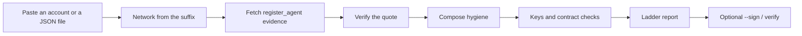

# Glassbox

Free, open-source (MIT) public auditor for AI-agent contracts on NEAR. Entered in the NEAR Hackathon, Security track.

Glassbox takes a NEAR account, or a pasted registration / app-compose / deployment JSON file, and prints one report. Every finding sits on a ladder: **PROVEN**, **NOT PROVEN**, or **RISKY**. Each line is plain English and, where a chain fact exists, links to it. The tool does not send transactions. It can sign a report file on your computer. That key stays on that computer.

It does not judge whether a payment is correct. That is [Gideon](#gideon), a separate project by the same builder.

## How Glassbox works

Glassbox answers one question: what was registered for this agent, and what can change it. It does not watch the guest, and it does not send a transaction.

You can ask in three places. The command line is `glassbox`. An agent tool is MCP `check_agent`. The web form is the public demo at https://glassbox-inky.vercel.app, and the same page from `pnpm --filter web dev`. That page also shows a proof strip: a dated saved snapshot of seven accounts and how their registered configurations landed on the ladder.

```text
account or file → network from the suffix → register_agent evidence → quote check (dcap-qvl + PCCS allowlist) → compose hygiene → access keys and contract checks → ladder report → optional --sign / verify
```



1. **Paste an account or a file.** A live account id is read from NEAR. JSON pasted on the website is the text in the form. A CLI local file is read on this computer when you pass a path to `glassbox`. The web form does not read local files.
2. **Network from the suffix.** `.testnet` is testnet. `.near` is mainnet. Anything else is tried on mainnet, then testnet.
3. **Fetch the registration evidence.** Glassbox looks up `register_agent` (or `register_worker`) and reads the arguments. It does not write to the chain.
4. **Verify the quote.** `@phala/dcap-qvl` checks the signature. Fresh collateral comes only from the PCCS allowlist. A caller cannot choose that host.
5. **Compose hygiene.** Image pins, public logs, secret-looking names, sockets, and the dstack image comparison. Values of secrets are not printed.
6. **Access keys and contract checks.** Who holds a full-access key, who can call `approve_codehash` or `approve_measurements`, whether `remove_codehash` or `remove_measurements` shows up, and whether the contract code hash matches a known Shade template. Missing evidence stays **NOT PROVEN**.
7. **Ladder report.** Each finding is PROVEN, NOT PROVEN, or RISKY. The report includes a threat-model paragraph: a valid quote is a TDX-attested registered configuration, not proof of an honest operator. It also states the registration time, how old that attestation is, and `valid_until_ms` when a Shade v2 view sent one. Those checks are proven at registration only. A registration is not a live process. By default Glassbox does not call a guest agent. Phala blocks those routes, so live observation stays **NOT PROVEN**.
8. **Optional `--sign` / `verify`.** `--sign` writes a hash and a local signature. `verify` checks those and re-reads the registration. `--anchor` only records that you asked to publish the hash later. It does not send a transaction.

`glassbox diff` compares two accounts or two JSON files and says what changed in the compose, the measurements, the codehash, and the findings.

## Do this

- Do install and test — see `pnpm install` then `pnpm test` (Node 20 or newer locally; CI runs Node 22).
- Do audit the captured votron registration on testnet — see `pnpm --filter cli start ac-sandbox.votron.testnet`.
- Do print the same report as JSON — see `pnpm --filter cli start ac-sandbox.votron.testnet --json`. `--json` stays that report when you also pass `--sign`.
- Do audit a file offline — see `node packages/cli/bin/glassbox.js packages/core/test/fixtures/votron-registration.json` from the repo root, or pass any registration, app-compose, or deployment JSON. Add `--json` for the machine report.
- Do sign a report — see `--sign`. The signed file is `report.json` unless you pass `--out`.
- Do check a signed report — see `glassbox verify report.json`.
- Do gate a compose in CI — see `--fail-on risky` and `.github/workflows/compose-hygiene.yml`.
- Do rebuild the proof strip — see `glassbox index` (local files) or `glassbox index --live` (the known accounts).
- Do smoke the other public targets — see `pnpm smoke`.
- Do run the MCP server — see `packages/mcp/README.md`. The tool is `check_agent`.
- Do open the web form — the public demo is https://glassbox-inky.vercel.app. The same form runs locally with `pnpm --filter web dev`, then http://localhost:3000.
- Do read how a finding is decided — see `packages/core/src/report.ts`.
- Do read how chain data is loaded — see `packages/core/src/audit.ts`.
- Do read the wording rules before editing copy — see `HANDOFF.md`.
- Do read dependency credits — see `NOTICE`.
- Do compare two files — see `node packages/cli/bin/glassbox.js diff fixtures/compose/pinned.json fixtures/compose/loose.json`.
- Do ask to anchor a report hash and see that nothing is sent — see `node packages/cli/bin/glassbox.js packages/core/test/fixtures/votron-registration.json --anchor`.

`ac-sandbox.votron.testnet` is the account suffix rule: `.testnet` selects testnet, `.near` selects mainnet. An account with neither suffix (such as `v1.signer`) is tried on mainnet, then testnet.

The first live read spends about half a minute. History comes from NearBlocks, and Glassbox waits between those calls so it stays inside the free personal-use limit (about 6 per minute).

## What the ladder means

| Ladder | Meaning in Glassbox |
| --- | --- |
| PROVEN | A direct check succeeded: a signature verified, two hashes were equal, or a view returned the value named in the sentence. |
| NOT PROVEN | The evidence was missing, the index may be incomplete, or the question is outside what a registration can show. This is not a pass. |
| RISKY | The registered configuration, or the account's keys, matched a concrete risk named in the sentence. |

The report also names the highest rung already on the ladder. That line is not a separate check. The counts stay the table of contents.

Every report prints the same threat-model paragraph. A valid Intel TDX quote proves a TDX-attested registered configuration. It does not prove an honest operator. TEE.fail showed that physical access to DDR5 memory can forge TDX quotes, including quotes that carry a dstack context. See https://tee.fail/.

### Saved seven-account snapshot for `ac-sandbox.votron.testnet` (2026-11-05)

`apps/web/data/proof-strip.json` is a saved seven-account snapshot (`source: live`, `generatedAt` `2026-11-05T10:21:06.337Z`). This pass did not re-query NearBlocks, so the counts below are that file, not a new chain read. The 2026-11-04 sample (6 risky, 3 not proven, 9 proven) is older than this snapshot and is not the current strip.

For `ac-sandbox.votron.testnet` the row is shade-v1, overall RISKY, **10 risky, 4 not proven, 13 proven**. The strip sentence for all seven accounts is `7 agents scanned · 0 proven · 4 match a vulnerable configuration · 3 not proven`. The zero is accounts whose bucket is proven. It is not a count of proven findings, and it is not a clean result.

That crawl is older than the contract, provenance, and freshness rows in the current report. A new live read would include those rows. It was not run here.

Titles on the votron row, copied from that file:

- PROVEN: quote signature verified, QE identity verified, TCB status at registration is UpToDate, quote is not a debug TD, report data binds the registering account, quote measurements match the registered tcb_info, RTMR replay matches, compose hash matches, images are pinned by digest, app codehash is in `approve_codehash` history, no plaintext secret values, images are not debug or dev images, interface is shade-v1.
- NOT PROVEN: no on-contract list of approved TDX measurements, registered image digests were not on the MPC allowlist, `allowed_envs` was not in the registered configuration, what the account is executing now was not observed.
- RISKY: access keys can change the account, no encrypted env, a guest-agent socket is mounted, `public_logs` is true, `public_sysinfo` is true, the registered configuration matches a vulnerable configuration, secret-looking env names, the 20 Nov 2026 schedule may apply, advisory IDs are attached, TCB is now OutOfDate.

Evidence labels on that row include registration transaction `HczqYXdRBZfyTtnQiPqGRXe3zEhvwHu3hyCUkqMq8VjN`, `/var/run/tappd.sock`, `NEAR_SEED_PHRASE` and `ANTHROPIC_API_KEY` (name only), and advisory IDs INTEL-SA-01192, INTEL-SA-01245, INTEL-SA-01312, INTEL-SA-01313, and INTEL-SA-01367. Values are not in the file. The vulnerable-configuration title is the registered-configuration heuristic. The offline capture of the same registration has no `os-image-hash` event, a `rootfs-hash` event, and `tappd.sock`. That is not an exact dstack version.

The redacted capture `packages/core/test/fixtures/votron-registration.json` is a CLI local file, not the website paste path and not this snapshot. Audited offline on this checkout with the report clock set to `2026-11-05T12:00:00.000Z`, it printed **8 risky, 10 not proven, 14 proven**. Fresh collateral is not fetched for a file, so `tdx.fresh` stayed NOT PROVEN ("TCB status now was not checked") and `tdx.advisories` stayed PROVEN ("No advisory IDs were returned") on the stored collateral. `tdx.registration` stayed PROVEN (UpToDate). `dstack.range` stayed RISKY (matches a vulnerable configuration). The capture's registration time in that report is 2025-09-27. Do not quote the file counts as the live index.

Source for the guest-agent issue: https://phala.com/posts/2026-10-post-mortem-dstack-guest-agent-vulnerability

## Sample

The live shape to cite is the saved index above: shade-v1, overall RISKY, 10 risky, 4 not proven, 13 proven, with `Powered by Nearblocks.io APIs.` in that file. `pnpm --filter cli start ac-sandbox.votron.testnet` still reads the chain. This pass did not run it, and a run on the current report would also print the contract, provenance, and freshness rows that the 10:21 index does not list.

## Signed reports

`--sign` writes a signed report next to the human text. `--json` still prints the report itself.

```bash
node packages/cli/bin/glassbox.js packages/core/test/fixtures/votron-registration.json --sign --out report.json
node packages/cli/bin/glassbox.js verify report.json --offline
```

The file holds the inputs (contract, agent, transaction, block height, collateral source and fetch time, Glassbox version, and `@phala/dcap-qvl`), the checks, and the verdict. It also holds the sha256 of that body and an ed25519 signature.

The first `--sign` creates a key at `~/.config/glassbox/report-signing-key.pem` (or `GLASSBOX_SIGNING_KEY` if you set that path). A second file beside it, ending in `.pub`, is the public key in hex. Keep the private file to yourself. Do not commit it.

`verify` checks the hash and the signature. When the report names a transaction, it reads that transaction again from the archival RPC. `.testnet` selects testnet. `.near` selects mainnet. An account with neither suffix uses the network recorded in the report. `--offline` checks the hash and signature only, which is how the saved votron file is checked without the network.

Fresh collateral, access keys, and the MPC allowlists can change after the report is signed. Verify leaves those as they were signed and recomputes the registration checks.

Anchoring the report hash on NEAR is a stub. `--sign` already hashes the canonical report body with sha256. `--anchor` and `GLASSBOX_ANCHOR=1` only record that you asked. The status stays `skipped`. This build does not build a Glassbox contract, does not build that call, does not load a NEAR signer, and does not spend gas. No account is required today. A live anchor is out of this submission.

## Diff

`glassbox diff` takes two accounts or two JSON files and prints what changed. It lines up the compose (logs, images, declared version, secret-looking names), the measurements (`os_image_hash`, MRTD, RTMR0–RTMR2), the app codehash and the contract code hash, and the ladder findings. It does not send a transaction.

```bash
node packages/cli/bin/glassbox.js diff fixtures/compose/pinned.json fixtures/compose/loose.json
node packages/cli/bin/glassbox.js diff packages/core/test/fixtures/diff-left.json packages/core/test/fixtures/diff-right.json
```

## MCP

Do install it for an agent owner — see `packages/mcp/README.md` for Claude Desktop and Cursor snippets.

`check_agent` takes a NEAR account or pasted JSON. It returns the same ladder as JSON, a one-sentence summary, and `overall` (the highest rung). Stdio transport. Run it from this checkout:

```bash
node packages/mcp/bin/glassbox-mcp.js
```

Publishing `glassbox-mcp` to npm is not part of this submission. Do not publish it. The install snippets in `packages/mcp/README.md` point at `node` and this repo's bin. There is no `npx glassbox-mcp` path to follow here.

`check_agent` accepts a NEAR account id or JSON text. It refuses a URL, and it refuses a caller-supplied collateral host. A burst of calls in one process is limited to about six a minute. A pasted JSON report says the file supplied the compared values. A verified quote in that file is a check of those bytes, not a fresh chain read.

This pass did not call `check_agent` against the network. The saved seven-account snapshot for `ac-sandbox.votron.testnet` (same file as the sample) is overall RISKY, shade-v1, 10 risky / 4 not proven / 13 proven, and it includes `Powered by Nearblocks.io APIs.` That snapshot is not a new MCP session.

## Compose check

[](https://github.com/Adelekejr/Glassbox/actions/workflows/compose-hygiene.yml)

The workflow runs on `main` with Node 22 and pnpm 10.33.4. Local `engines` allows Node 20 or newer. CI does not run a second Node version. The workflow is a CI gate. The public demo is https://glassbox-inky.vercel.app.

The Action runs `glassbox check fixtures/compose/pinned.json --fail-on risky`. That file is a pinned compose. It does not call a chain. The job fails when the audit has a risky finding. `fixtures/compose/loose.json` is the example that fails the gate (unpinned image, public logs, a socket mount). The same workflow also runs `pnpm test` on pull requests and pushes. That script runs the package tests and `pnpm run typecheck`. The compose gate is unchanged.

```bash
node packages/cli/bin/glassbox.js check fixtures/compose/pinned.json --fail-on risky
```

## Proof strip

The web form shows one line from the saved seven-account snapshot, with the date beside the counts: `7 agents scanned · 0 proven · 4 match a vulnerable configuration · 3 not proven` (`generatedAt` `2026-11-05T10:21:06.337Z`). The zero is accounts in the proven bucket. Not proven is not a clean result. An account that is risky only because of its keys is counted in not proven on that line. The row's own ladder is the full result.

Rebuild it from the local fixtures (no NearBlocks calls):

```bash
node packages/cli/bin/glassbox.js index
```

The same command is `pnpm --filter core index`. It writes `apps/web/data/proof-strip.json` and `apps/web/public/proof-strip.html`.

To read the known accounts, which does call NearBlocks and waits between calls (about 6 a minute):

```bash
node packages/cli/bin/glassbox.js index --live
```

That crawl is the seven-account snapshot: testnet `ac-sandbox.votron.testnet`, `ac-sandbox.ajitesh-1.testnet`, `ac-sandbox.nova-shade-agent.testnet`, `ac-sandbox.leo-leo-leo.testnet`, and `ac-proxy.leo-leo-leo.testnet`, plus mainnet `reflect-adam-mainnet-agent-contract.near` and `ironshield.near`. It reads `register_agent`, and `register_worker` for a worker proxy. The saved snapshot prints `Powered by Nearblocks.io APIs.` when NearBlocks was used. Secret values are left out. The row shows the configuration class and redacted evidence. `worker.outlayer.testnet` and the MPC allowlist accounts in Public targets are smoke checks. They are not members of this snapshot.

Try the mainnet accounts, then check a signed report. These commands read public data. They do not send a transaction.

```bash
pnpm --filter cli start reflect-adam-mainnet-agent-contract.near
pnpm --filter cli start ironshield.near --sign --out report.json
node packages/cli/bin/glassbox.js verify report.json
```

## Web

The public demo is https://glassbox-inky.vercel.app. The same form runs locally with `pnpm --filter web dev`, then http://localhost:3000. Paste a live account (the hint names testnet or mainnet from the suffix) or JSON text. JSON pasted on the site is the text in the form. A CLI local file is read only when you pass a path to `glassbox`. The page POSTs to `/api/audit`, which calls the core library and does not read local files. The preferred production limiter is Upstash Redis: set both `UPSTASH_REDIS_REST_URL` and `UPSTASH_REDIS_REST_TOKEN` (or the `KV_REST_API_URL` / `KV_REST_API_TOKEN` pair). When that store is present, admission uses the shared budget of 10 audits per minute and 2 at a time for the whole deployment, including when the demo flag is also set. When `GLASSBOX_AUDIT_TOKEN` is set and no shared store is configured, callers must send header `x-glassbox-audit-token`. `GLASSBOX_PUBLIC_DEMO=1` is process-local demo mode. It keeps anonymous access with a cap of 10 per minute in that one process. That cap resets on restart and is not shared across instances. The public demo uses this flag until those Redis variables are set. With none of those set, the route returns 403 and does not call RPC. The top of the page is the saved seven-account snapshot. Styling is plain on purpose.

## Shade v2

Do run the local sandbox test — see `packages/core/test/shade-v2.sandbox.test.ts`. It starts a local NEAR sandbox, deploys `shade-contract-template` from NearDeFi/shade-agent-framework commit `35758f3` (Apache-2.0 wasm in `packages/core/test/fixtures/`), approves the local-mode measurements, registers an agent, and audits that RPC. No testnet transaction. The registered measurements match `get_approved_measurements`. They are the all-zero local-mode default, which the report marks as not a TDX measurement.

## Approval history

Do read the dated approve/remove section — see the "Approval history" block in `formatReport` (`packages/core/src/report.ts`). For one contract, Glassbox asks NearBlocks for the approve and remove methods that match the interface (`approve_codehash` / `remove_codehash`, or `approve_measurements` / `remove_measurements` / ppids). Results are cached in memory for 10 minutes. It is not a watcher.

## Layout

| Path | Role |
| --- | --- |
| `packages/core` | Audit library. `pnpm --filter core test` runs the fixture tests. |
| `packages/cli` | `glassbox <account-or-file>`. `start` is the command above. |
| `packages/mcp` | `check_agent` over stdio. Bin `glassbox-mcp`. Not published. |
| `apps/web` | Web form and the proof strip. Public demo: https://glassbox-inky.vercel.app. Local: `pnpm --filter web dev`. |
| `packages/core/test/fixtures/votron-registration.json` | Redacted capture of the votron `register_agent` arguments. |
| `packages/core/scripts/smoke.ts` | Live read of the other public targets. |

## Sources

Chain reads use free public endpoints, FastNEAR first and `near.org` as fallback: `rpc.testnet.fastnear.com`, `rpc.mainnet.fastnear.com`, and the matching `rpc.*.near.org` hosts. Old transactions use `archival-rpc.testnet.fastnear.com` (near.org archival is the fallback). Calls are spaced.

History: FastNEAR's tx index (`tx.test.fastnear.com` / `tx.main.fastnear.com` `/v0/account`) returned HTTP 404 on 2026-11-04, so Glassbox uses the NearBlocks API and prints "Powered by Nearblocks.io APIs" when it does. NearBlocks' free tier is personal use.

TDX quotes: `@phala/dcap-qvl` 0.7.1 (Apache-2.0). That build is after the QE-identity fix in 0.3.9 (GHSA-796p-j2gh-9m2q) and the JavaScript CRL fix in 0.5.3. The report states this version. QE identity, the quote signature, TCB status at registration, TCB status now, the debug bit, and advisory IDs are separate checks. TCB status is a verdict: anything other than UpToDate is risky. Fresh collateral is fetched only from the hardcoded allowlist (`https://pccs.phala.network`, plus Intel collateral hosts the library may contact). A caller-supplied PCCS URL is rejected.

Registered app-compose hygiene (each risky when it matches, with an evidence path): plaintext secret values (name and a 4-character sha256 prefix only), `public_logs` / `public_sysinfo`, images not pinned by sha256, `docker.sock` / `tappd.sock` / `dstack.sock` mounts, `kms_enabled: false` or no encrypted env, overly broad `allowed_envs`, and debug or dev images. Credits: `NOTICE`.

dstack fixed image hashes, checked 2026-11-04: dstack-0.5.12 `8db40cb2…`, dstack-dev-0.5.12 `e866e987…`, dstack-nvidia-0.5.12 `91fd5d69…`, dstack-nvidia-dev-0.5.12 `e0c9312d…`, dstack-0.6.1 `ec43cb8c…`. Those names are published `os_image_hash` values. Glassbox does not claim support for GPU guests. A declared `dstack_version` is not a proven fixed image; the `os_image_hash` is the comparison when it is present. Shade's Apache-2.0 tables cover only dstack 0.5.7 and 0.5.8 (`shade-agent-cli/src/utils/measurements.js`). A hit on those tables matches a vulnerable configuration. A hash outside the fixed list is not a known fixed image. No `os_image_hash` and no table hit is unknown.

TEE.fail, physical DDR5 and forged TDX quotes, including dstack contexts: https://tee.fail/

MPC allowlists: view `allowed_docker_image_hashes` on `v1.signer` (mainnet) and `v1.signer-prod.testnet`. `v1.signer.testnet` does not exist.

## Public targets exercised

The seven-account snapshot is the first table. The second table is smoke and MPC targets. Those rows are not members of the snapshot.

| Account | Seven-account snapshot |
| --- | --- |
| `ac-sandbox.votron.testnet` | Shade v1, own code. Registration above. |
| `ac-sandbox.ajitesh-1.testnet` | Shade v1, own code. |
| `ac-sandbox.nova-shade-agent.testnet` | Global contract `GMXJXnVK9vYd7CSYPtbA56rPau2h5J4YjsSsCfegGi4G`. |
| `ac-sandbox.leo-leo-leo.testnet` | Global contract `31x2yS1DZHUjMQQFXPBjbfojb4FQ8pBaER39YoReTpJb`. |
| `ac-proxy.leo-leo-leo.testnet` | Worker proxy, global contract `2pSLLgLnAM9PYD7Rj6SpdK9tJRz48GQ7GrnAXK6tmm8u`. |
| `reflect-adam-mainnet-agent-contract.near` | Mainnet demo account. `.near` selects mainnet. |
| `ironshield.near` | Mainnet. Shade v2 interface in the saved snapshot. That row loaded no registration quote (`No registration quote was loaded`) and did not load approved measurements (`Approved measurements were not loaded`). Those checks stay NOT PROVEN. The only PROVEN row on it is the interface itself. Overall RISKY because of a full-access key (1 proven, 6 not proven, 1 risky). |

| Account | Smoke or MPC, not in the snapshot |
| --- | --- |
| `worker.outlayer.testnet` | `get_approved_measurements`. Not Shade v2 (`get_contract_info` is absent). RTMR1 `a7b52327…` is in neither Shade table. |
| `v1.signer-prod.testnet` and `v1.signer` | MPC docker allowlists. Two hashes each; one hash expires 5 Nov 2026 (testnet) and 6 Nov 2026 (mainnet). |

`ironshield.near` is the Shade v2 interface in that index. It is not a verified v2 TEE registration: no quote, and approved measurements were not loaded. The local sandbox test is still the path that approves measurements and compares them. That sandbox uses the all-zero local-mode default, which is not a TDX measurement. The account the notes call "1prime" was not located.

## Gideon

Gideon is the sibling project by the same builder (Adelekejr). It is a NEAR pre-send safety checker. The public repository is [https://github.com/Adelekejr/Gideon-near](https://github.com/Adelekejr/Gideon-near). Gideon names Glassbox as the registration auditor.

Hackathon screening question Q-015 asks for that sibling to be named.

Glassbox answers what was registered, whether the quote verifies, and who can change it. Gideon checks a payment before it is sent. They do not share a verdict. Glassbox does not add a payment or send screen. That work stays in Gideon.

## Repository

Glassbox is public at [https://github.com/Adelekejr/Glassbox](https://github.com/Adelekejr/Glassbox).

## Licence

MIT, copyright 2026 Adelekejr. See `LICENSE`. Apache-2.0 dependencies keep their notices in `NOTICE`.
