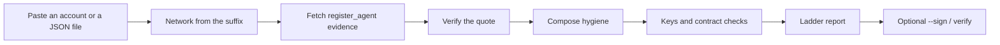

# Glassbox

Glassbox checks what a NEAR AI agent was registered to run, what that evidence actually proves, and who can change it.

## The problem

An agent can advertise that it runs in a secure enclave while its owner still holds a full-access key. That key can replace the contract and change what the account accepts. A badge does not show the key, and it does not show whether anyone checked the enclave evidence.

A **TEE** (trusted execution environment) is a processor mode meant to show which software ran. **Intel TDX** is one such mode. A **TDX quote** is the signed statement the processor makes about that software. **dstack** is Phala's software for running an app in TDX and producing the quote. **Shade** is the NEAR contract framework these agents register through. A **full-access key** on NEAR can do anything on the account, including deploy new code.

## What Glassbox does

Glassbox is a free, open-source (MIT) auditor for those registrations. Give it a NEAR account, or a registration, app-compose, or deployment JSON file, and it prints one report. Every finding is **PROVEN**, **NOT PROVEN**, or **RISKY**. **NOT PROVEN is never a pass.** The tool does not send a transaction, and it does not decide whether a payment is correct. Payments are [Gideon](#gideon), a separate project by the same builder.

## Try it live

[https://glassbox-inky.vercel.app](https://glassbox-inky.vercel.app)

The form's examples are `ac-sandbox.votron.testnet`, `ironshield.near`, and `reflect-adam-mainnet-agent-contract.near`.

## A result from 10 Nov 2026

`pnpm --filter cli start ac-sandbox.votron.testnet` finished in about 90 seconds. The report was generated at `2026-11-10T14:16:09.350Z`.

| | |
| --- | --- |
| Account | `ac-sandbox.votron.testnet` (testnet) |
| Interface | shade-v1. Shade v1 approves an app code hash. It has no view that lists approved TDX measurements. |
| Verdict | **RISKY** |
| Counts | **10 risky, 8 not proven, 14 proven** |

The report opens with: "The owner of this agent can still change its code at any time, so its secure-enclave promise does not fully hold. The software this agent registered matches a known weak setup." Then: "What to do: Do not treat this agent as locked down." Those lines are chosen from the findings. The full-access key is why the ladder stops at RISKY: that key can redeploy the contract. The registration quote from 27 Sep 2025 (`HczqYXdRBZfyTtnQiPqGRXe3zEhvwHu3hyCUkqMq8VjN`) did verify, including an UpToDate TCB status at that time. That verification is not a pass. The same quote is OutOfDate against fresh collateral, and the registered configuration matches a vulnerable dstack pattern: it mounts `/var/run/tappd.sock` and has no `os-image-hash` event. That pattern is an inference. It fits dstack before 0.5 and does not name an exact release.

The same afternoon, `ironshield.near` was **RISKY** as well: **1 risky, 11 not proven, 1 proven** (generated `2026-11-10T14:18:04.647Z`). The same opening lines say the owner can still change the code, and that this agent has not published proof it runs inside a secure enclave. History found three successful `register_agent` calls, and none of them included a TDX quote. The risky finding is the full-access key. The account's code hash is the empty-contract hash (`11111111111111111111111111111111`). The report's one PROVEN row says the interface is shade-v2, because a call that fails with `CodeDoesNotExist` is counted as "the method is present." Direct views that day failed with `CompilationError(CodeDoesNotExist)`. The shade-v2 line is not proof that a Shade contract is deployed there.

Reports now open with one or two short sentences and a "What to do" line. Those sentences are chosen from findings already on the ladder. The wording says a check came back proven only when every finding is PROVEN. The counts above were read from the ladder itself.

## The ladder

| Ladder | Meaning in Glassbox |
| --- | --- |
| PROVEN | A direct check succeeded: a signature verified, two hashes were equal, or a view returned the value named in the sentence. |
| NOT PROVEN | The evidence was missing, the index may be incomplete, or the question is outside what a registration can show. This is not a pass. |
| RISKY | The registered configuration, or the account's keys, matched a concrete risk named in the sentence. |

The report also names the highest rung already on the ladder. That line is not a separate check. The counts are the table of contents. One RISKY finding makes the whole report RISKY, even when other rows are PROVEN.

Every report prints the same threat-model paragraph. A valid Intel TDX quote proves a TDX-attested registered configuration, not an honest operator. That includes a quote that carries a dstack context. [TEE.fail](https://tee.fail/) showed that physical access to DDR5 memory can forge TDX quotes, including quotes for dstack contexts.

## Why most of these agents come back RISKY or NOT PROVEN

A full-access key is enough. The key holder can swap the code after a quote was registered. A verified quote describes the registered configuration. It does not show what the account is executing now, and it does not show an honest operator.

`glassbox index --live` on 10 Nov 2026, finished at `2026-11-10T14:24:42.961Z`, read the seven accounts this repo crawls. The strip sentence was `7 agents scanned · 0 proven · 4 match a vulnerable configuration · 3 not proven`. That sentence counts buckets, not findings. Every account's own ladder was **RISKY**, and every report included a full-access key. Four registered configurations matched a vulnerable configuration: votron, ajitesh-1, nova-shade-agent, and `ac-sandbox.leo-leo-leo.testnet`. The other three were still RISKY because of the key, and no registration quote was loaded: `ac-proxy.leo-leo-leo.testnet`, `reflect-adam-mainnet-agent-contract.near`, and `ironshield.near`. Both mainnet accounts in that set were in that last group.

Missing enclave evidence stays NOT PROVEN. `ironshield.near` had three successful registrations and no TDX quote in them. On Shade v1, a registration that never loads leaves the quote checks NOT PROVEN as well. Either way, NOT PROVEN is not a clean result. The bucket sentence happened to match the saved 5 Nov file. The per-account counts did not. Votron in that file is 10 risky, 4 not proven, 13 proven. The live read the same week was 10 risky, 8 not proven, 14 proven.

The public site still shows a saved seven-account snapshot from `2026-11-05T10:21:06.337Z` (`apps/web/data/proof-strip.json`): `7 agents scanned · 0 proven · 4 match a vulnerable configuration · 3 not proven`. Those zeros and fours are buckets on that old file, not a count of findings, and not this week's chain read. The votron row in that file is 10 risky, 4 not proven, 13 proven. The live read on 10 Nov 2026 was 10 risky, 8 not proven, 14 proven.

## How it works

Glassbox answers one question: what was registered for this agent, and what can change it. It does not watch the guest, and it does not send a transaction.

You can ask in three places. The command line is `glassbox`. An agent tool is the MCP server's `check_agent`. The web form is the public demo, and the same app from `pnpm --filter web dev`.

```text
account or file → network from the suffix → register_agent evidence → quote check (dcap-qvl + PCCS allowlist) → compose hygiene → access keys and contract checks → ladder report → optional --sign / verify
```



1. **Paste an account or a file.** A live account id is read from NEAR. JSON pasted on the website is the text in the form. A CLI local file is read on this computer when you pass a path to `glassbox`. The web form does not read local files.
2. **Network from the suffix.** `.testnet` is testnet. `.near` is mainnet. Anything else is tried on mainnet, then testnet. `v1.signer` is the account that takes that second path.
3. **Fetch the registration evidence.** Glassbox looks up `register_agent`, or `register_worker` on a worker proxy, and reads the arguments. The method list comes from the NearBlocks v3 receipts API. The call arguments come from the archival NEAR RPC. A failed history read stays NOT PROVEN. It is not described as an empty index. Glassbox does not write to the chain.
4. **Verify the quote.** `@phala/dcap-qvl` 0.7.1 checks the signature. Fresh collateral is fetched only from the built-in allowlist, starting at `https://pccs.phala.network`. A caller cannot choose that host. The stored collateral is checked at the registration time. Checking that old bundle "now" fails because the collateral has expired, which is a different fact from a later TCB status.
5. **Compose hygiene.** Image pins, public logs, secret-looking names, sockets, and the dstack image comparison. Values of secrets are not printed. A plaintext secret is the name plus a short hash prefix.
6. **Access keys and contract checks.** Who holds a full-access key, who can call `approve_codehash` or `approve_measurements`, whether `remove_codehash` or `remove_measurements` shows up, and whether the contract code hash matches the one Shade template this build knows. Missing evidence stays **NOT PROVEN**. A string that is not a real digest, including the placeholder `not-in-a-tee`, does not prove which code runs.
7. **Ladder report.** Each finding is PROVEN, NOT PROVEN, or RISKY. The report states the registration time, how old that attestation is, and `valid_until_ms` when a Shade v2 agent view sent one. Those checks are about the registration. A registration is not a live process. By default Glassbox does not call a guest agent. Phala blocks public guest-agent routes, so live observation stays **NOT PROVEN**.
8. **Optional `--sign` / `verify`.** `--sign` writes a hash and a local ed25519 signature. `verify` checks those and, unless you pass `--offline`, re-reads the registration transaction. `--anchor` only records that you asked to publish the hash later. It does not send a transaction.

`glassbox diff` compares two accounts, two JSON files, or two saved reports and says what changed in the compose, the measurements, the code hash, and the findings.

## Commands

From the repo root, after `pnpm install`. Local `engines` allow Node 20 or newer. CI runs Node 22 and pnpm 10.33.4. These commands were run on Node v22.23.4 on 10 Nov 2026. `pnpm test` passed: core 70, cli 7, mcp 6, web 18, the daily-health script 3, then the TypeScript check. That script does not read the chain. It does include the local Shade v2 sandbox test and the health-file parser tests.

| What | Command |
| --- | --- |
| Install | `pnpm install` |
| Test | `pnpm test` |
| Audit a live account | `pnpm --filter cli start ac-sandbox.votron.testnet` |
| Same report as JSON | `pnpm --filter cli start ac-sandbox.votron.testnet --json` |
| Audit a file offline | `node packages/cli/bin/glassbox.js packages/core/test/fixtures/votron-registration.json` |
| Sign that file | `node packages/cli/bin/glassbox.js packages/core/test/fixtures/votron-registration.json --sign --out report.json` |
| Check the signature only | `node packages/cli/bin/glassbox.js verify report.json --offline` |
| Ask to anchor, and send nothing | `node packages/cli/bin/glassbox.js packages/core/test/fixtures/votron-registration.json --anchor` |
| Compare two compose files | `node packages/cli/bin/glassbox.js diff fixtures/compose/pinned.json fixtures/compose/loose.json` |
| Compare two saved reports | `node packages/cli/bin/glassbox.js diff packages/core/test/fixtures/diff-left.json packages/core/test/fixtures/diff-right.json` |
| CI gate on a pinned compose | `node packages/cli/bin/glassbox.js check fixtures/compose/pinned.json --fail-on risky` |
| Rebuild the proof strip from local files | `node packages/cli/bin/glassbox.js index` |
| Rebuild it from the seven known accounts | `node packages/cli/bin/glassbox.js index --live` |
| Smoke the other public targets | `pnpm smoke` |
| MCP server | `node packages/mcp/bin/glassbox-mcp.js` |
| Web form | `pnpm --filter web dev`, then http://localhost:3000 |

`--json` still prints the report when you also pass `--sign`. The signed file is `report.json` unless you pass `--out`. `--out` turns signing on.

NearBlocks calls wait 10.5 seconds apart (about six a minute). The votron read above took about 90 seconds because several history calls each wait, and each call's arguments are then loaded from archival RPC.

The offline votron capture, audited on 10 Nov 2026, printed **8 risky, 10 not proven, 14 proven**. Its registration time is 27 Sep 2025. Fresh collateral is not fetched for a file, so "TCB status now" stayed NOT PROVEN and the stored collateral still said no advisory IDs. Do not quote the file counts as the live account.

## Signed reports

```bash
node packages/cli/bin/glassbox.js packages/core/test/fixtures/votron-registration.json --sign --out report.json
node packages/cli/bin/glassbox.js verify report.json --offline
```

The signed file holds the inputs (contract, agent, transaction, block height when known, collateral source and fetch time, Glassbox version, and `@phala/dcap-qvl`), the checks, and the verdict. It also holds the sha256 of that body and an ed25519 signature. Block height is null when the input did not record one.

The first `--sign` creates a key at `~/.config/glassbox/report-signing-key.pem`, or at `GLASSBOX_SIGNING_KEY` if you set that path. A second file beside it, ending in `.pub`, is the public key in hex. Keep the private file to yourself. Do not commit it.

`verify --offline` checks the hash and the signature only. On 10 Nov 2026 that check matched for a report signed from the votron capture.

`verify` without `--offline` also re-reads the registration from archival RPC when the report names a transaction. `.testnet` selects testnet. `.near` selects mainnet. An account with neither suffix uses the network recorded in the report. Fresh collateral, access keys, and the MPC allowlists are left as they were signed. On that same signed capture, the hash and signature matched, and the recomputed quote checks moved from PROVEN to NOT PROVEN. The recompute does not apply the registration timestamp. The same quote from the archival transaction verifies as UpToDate at the registration time (27 Sep 2025) and fails with `TCBInfo expired` if it is checked at the current time. Use `--offline` when you only want the hash and the signature.

Anchoring the report hash on NEAR is a stub. `--sign` already hashes the canonical report body with sha256. `--anchor` and `GLASSBOX_ANCHOR=1` only record that you asked. The status stays `skipped`. This build does not build a Glassbox contract, does not build that call, does not load a NEAR signer, and does not spend gas.

## Diff

`glassbox diff` lines up the compose (logs, images, declared version, secret-looking names), the measurements (`os_image_hash`, MRTD, RTMR0–RTMR2), the app code hash and the contract code hash, and the ladder findings. For saved reports it also shows each check time and registration identity. When the registration transaction is the same, a changed `tdx.fresh` result is attributed to the TCB/collateral baseline. When identity is missing or different, Glassbox says it cannot make that attribution. It does not send a transaction.

```bash
node packages/cli/bin/glassbox.js diff fixtures/compose/pinned.json fixtures/compose/loose.json
node packages/cli/bin/glassbox.js your-agent.testnet --json > check-t1.json
node packages/cli/bin/glassbox.js your-agent.testnet --json > check-t2.json
node packages/cli/bin/glassbox.js diff check-t1.json check-t2.json
```

## MCP

Install notes for Claude Desktop and Cursor are in `packages/mcp/README.md`.

`check_agent` takes a NEAR account or pasted JSON. It returns the same ladder as JSON, `overall` (the highest rung), `summary` (that rung and the counts), and `plainSummary` (the short sentences and the "What to do" line). Stdio transport. Run it from this checkout:

```bash
node packages/mcp/bin/glassbox-mcp.js
```

`glassbox-mcp` is not on npm. The bin is `node` plus `packages/mcp/bin/glassbox-mcp.js`. There is no `npx glassbox-mcp` package to run.

`check_agent` refuses a URL, a local path, and a caller-supplied collateral host. One process accepts six calls a minute. A pasted JSON report compares values in that text, or verifies a quote carried in it. That is not a fresh chain read.

## Compose check

[](https://github.com/Adelekejr/Glassbox/actions/workflows/compose-hygiene.yml)

`.github/workflows/compose-hygiene.yml` runs on every push and pull request. Both jobs use Node 22 and pnpm 10.33.4. CI does not run a second Node version. Local `engines` allow Node 20 or newer.

One job runs `glassbox check fixtures/compose/pinned.json --fail-on risky`. That file is a pinned compose. It does not call a chain. On 10 Nov 2026 it printed 0 risky, 11 not proven, 9 proven, and exited 0. NOT PROVEN does not fail `--fail-on risky`. `fixtures/compose/loose.json` is the example that fails the gate (8 risky: unpinned image, public logs, a socket mount, and the other compose findings). `glassbox check` only audits a local file. It does not fetch fresh collateral. When a risky finding is present, the command also prints a note that a risky row can come from TCB freshness.

The other job runs `pnpm test` and then `pnpm --filter web build`.

```bash
node packages/cli/bin/glassbox.js check fixtures/compose/pinned.json --fail-on risky
```

`--fail-on` accepts `risky`, `not-proven` (or `not_proven`), and `proven`.

## Web

The public demo is [https://glassbox-inky.vercel.app](https://glassbox-inky.vercel.app). On 10 Nov 2026 the home page returned HTTP 200. A POST to `/api/audit` returned `x-glassbox-rate-limit-scope: shared`, which is the deployment-wide budget: 10 audits a minute and 2 at a time. The page shows the audit form and, beside it, the saved seven-account snapshot. There is also an account list at `/accounts`.

`pnpm --filter web dev` serves the same app at http://localhost:3000. The page loads. With no limiter configured, POST `/api/audit` returns 403 and does not call RPC. Set one of these:

- `UPSTASH_REDIS_REST_URL` and `UPSTASH_REDIS_REST_TOKEN` (or `KV_REST_API_URL` and `KV_REST_API_TOKEN`) for the shared budget of 10 per minute and 2 in flight. Redis wins when it is present, including when the demo flag is also set.
- `GLASSBOX_AUDIT_TOKEN`, when no shared store is set. Callers send header `x-glassbox-audit-token`.
- `GLASSBOX_PUBLIC_DEMO=1` for anonymous access capped at 10 per minute in that one process. The cap resets on restart and is not shared across instances.

The route accepts a NEAR account id or JSON text. It does not read local files. The form shows the plain summary above the rung counts.

## Status

[https://glassbox-inky.vercel.app/status](https://glassbox-inky.vercel.app/status) is the public status page. `.github/workflows/health.yml` runs every day at 06:17 UTC, and it can be started by hand. It audits `ac-sandbox.votron.testnet` and `ironshield.near`, 75 seconds apart, and it requests the same NearBlocks v3 receipts URLs the auditor uses. The job writes `health.json` on the `status` branch even when a check fails, then exits non-zero on failure. The page and the footer read that file. They do not call the Actions API, and the browser does not receive a token. The labels are "All checks passing", "Check failing", and "Status unknown". Unknown is not a pass. The file is cached for about 10 minutes.

On 10 Nov 2026 the live page said "Status unknown" and "Last checked unknown". `https://raw.githubusercontent.com/Adelekejr/Glassbox/status/health.json` returned HTTP 404. No daily result had been published yet.

## Proof strip

`apps/web/data/proof-strip.json` is the saved snapshot described above. Rebuilding without `--live` replaces that file with three local fixtures:

```bash
node packages/cli/bin/glassbox.js index
```

On 10 Nov 2026 that local rebuild printed `3 agents scanned · 0 proven · 2 match a vulnerable configuration · 1 not proven`. The same command is `pnpm --filter core index`. It writes `apps/web/data/proof-strip.json` and `apps/web/public/proof-strip.html`. Pass `--out` and `--html` if you do not want to replace the saved snapshot. `pnpm --filter core index --live` forwards `--live`. A bare `--` before the flag is rejected.

```bash
node packages/cli/bin/glassbox.js index --live
```

`--live` reads these seven accounts: testnet `ac-sandbox.votron.testnet`, `ac-sandbox.ajitesh-1.testnet`, `ac-sandbox.nova-shade-agent.testnet`, `ac-sandbox.leo-leo-leo.testnet`, and `ac-proxy.leo-leo-leo.testnet`, plus mainnet `reflect-adam-mainnet-agent-contract.near` and `ironshield.near`. It reads `register_agent`, and `register_worker` for a worker proxy. The strip sentence counts buckets. An account that is RISKY only because of its keys, with no "vulnerable configuration" finding, is counted in the not-proven bucket. The row's own ladder is the full result. Secret values are left out.

`worker.outlayer.testnet` and the MPC allowlist accounts below are smoke targets. They are not in this snapshot.

## Shade v2 sandbox

`pnpm test` includes `packages/core/test/shade-v2.sandbox.test.ts`. It starts a local NEAR sandbox, deploys `shade-contract-template` from NearDeFi/shade-agent-framework commit `35758f3` (Apache-2.0 wasm in `packages/core/test/fixtures/`), approves the local-mode measurements, registers an agent, and audits that RPC. No testnet transaction. The registered measurements are the all-zero local-mode default, which the report marks as not a TDX measurement.

## Approval history

The "Approval history" block in a report is one contract, on demand, cached in memory for 10 minutes (`GLASSBOX_HISTORY_CACHE_MS`). Shade v1 reads `approve_codehash` and `remove_codehash`. Shade v2 reads `approve_measurements`, `remove_measurements`, `approve_ppids`, and `remove_ppids`. It is not a watcher.

## Data sources

Chain reads use public endpoints, FastNEAR first and `near.org` as fallback:

- `https://rpc.testnet.fastnear.com`, `https://rpc.mainnet.fastnear.com`
- `https://rpc.testnet.near.org`, `https://rpc.mainnet.near.org`
- Archival: `https://archival-rpc.testnet.fastnear.com`, `https://archival-rpc.mainnet.fastnear.com`, then the matching `archival-rpc.*.near.org` hosts

Ordinary RPC calls are spaced about 300 ms apart. Archival calls are spaced about 1 second apart. The client does not sign and does not send a transaction.

History tries FastNEAR's tx index first (`https://tx.test.fastnear.com/v0/account/…` and `https://tx.main.fastnear.com/v0/account/…`). On 10 Nov 2026 both of those URLs, for votron and for ironshield, returned HTTP 404, so the client fell through. NearBlocks is `https://api-testnet.nearblocks.io` and `https://api.nearblocks.io`, path `/v3/accounts/{account}/receipts?method=&limit=25`. The old testnet `/v1/account/…/txns` URL returned HTTP 410 the same day, with the body "API v1 was retired on 2026-11-05. Use /v3". Glassbox does not call v1. When NearBlocks is used, the report contains `Powered by Nearblocks.io APIs.`

TDX quotes use `@phala/dcap-qvl` 0.7.1 (Apache-2.0). The report states this version. QE identity has been mandatory in that library since 0.3.9 (GHSA-796p-j2gh-9m2q). The JavaScript CRL fix is in 0.5.3 (GHSA-2cjj-h43h-m6xj). QE identity, the quote signature, TCB status at registration, TCB status now, the debug bit, and advisory IDs are separate checks. Anything other than UpToDate is risky. Fresh collateral may contact only `pccs.phala.network`, `api.trustedservices.intel.com`, and `certificates.trustedservices.intel.com`. A caller-supplied PCCS URL is rejected.

Registered app-compose checks, each risky when it matches: plaintext secret values (name and a 4-character sha256 prefix only), `public_logs` / `public_sysinfo`, images not pinned by sha256, `docker.sock` / `tappd.sock` / `dstack.sock` mounts, `kms_enabled: false` or no encrypted env, overly broad `allowed_envs`, and debug or dev images.

The fixed-image list in `packages/core/src/data/fixed-images.ts` (comment dated 2026-11-04) is five published `os_image_hash` values: dstack-0.5.12 `8db40cb2…`, dstack-dev-0.5.12 `e866e987…`, dstack-nvidia-0.5.12 `91fd5d69…`, dstack-nvidia-dev-0.5.12 `e0c9312d…`, dstack-0.6.1 `ec43cb8c…`. A declared `dstack_version` is not a proven fixed image. The `os_image_hash` is the comparison when it is present. Shade's Apache-2.0 tables in this repo cover only dstack 0.5.7 and 0.5.8. A hit on those tables matches a vulnerable configuration. A hash outside the fixed list is not a known fixed image, and the list can lag a newer release. No `os_image_hash` and no table hit stays unknown. Glassbox compares those nvidia hashes when they appear. It does not claim a separate GPU-guest audit.

TEE.fail: [https://tee.fail/](https://tee.fail/). The dstack guest-agent post-mortem: [https://phala.com/posts/2026-10-post-mortem-dstack-guest-agent-vulnerability](https://phala.com/posts/2026-10-post-mortem-dstack-guest-agent-vulnerability).

MPC allowlists are the view `allowed_docker_image_hashes` on `v1.signer` (mainnet) and `v1.signer-prod.testnet`. On 10 Nov 2026 each list returned one hash, `536d528f19cff6a45f384fb225e8a331e5554b9da45196d0fae148d191e8b36d`, with no expiry. `v1.signer.testnet` does not exist (the testnet RPC returned `UNKNOWN_ACCOUNT`). A miss against this list is not a Shade failure. It is a different system's docker allowlist.

## Public targets

| Account | What a live read is for |
| --- | --- |
| `ac-sandbox.votron.testnet` | Shade v1, its own code. Result above. |
| `ac-sandbox.ajitesh-1.testnet` | In the seven-account crawl. |
| `ac-sandbox.nova-shade-agent.testnet` | In the seven-account crawl. |
| `ac-sandbox.leo-leo-leo.testnet` | In the seven-account crawl. |
| `ac-proxy.leo-leo-leo.testnet` | Worker proxy in the seven-account crawl. |
| `reflect-adam-mainnet-agent-contract.near` | Mainnet. `.near` selects mainnet. |
| `ironshield.near` | Mainnet. Result above. No contract code on 10 Nov 2026. |
| `worker.outlayer.testnet` | Smoke target. `get_approved_measurements` answered and `get_contract_info` was missing, so this build classifies it as a measurements registry, not Shade v2. One approved row's RTMR1 starts with `a7b52327`, which is in neither Shade 0.5.7 nor 0.5.8 table in this repo. |
| `v1.signer` and `v1.signer-prod.testnet` | MPC docker allowlists. Not Shade agent contracts. |

`pnpm smoke` reads the five testnet crawl accounts plus `worker.outlayer.testnet`, `v1.signer-prod.testnet`, and `v1.signer`. It does not include `ironshield.near` or `reflect-adam-mainnet-agent-contract.near`. The run on 10 Nov 2026 exited 0 at about 14:30 UTC. `worker.outlayer.testnet` was a measurements registry and RISKY for a full-access key (1 risky, 7 not proven, 2 proven). `v1.signer-prod.testnet` was an mpc-signer and RISKY for a full-access key (1 risky, 7 not proven, 2 proven). `v1.signer` was an mpc-signer with no risky finding (0 risky, 8 not proven, 2 proven), so the highest rung is NOT PROVEN. Zero risky findings is not a pass.

## Where to read the code

| Path | Role |
| --- | --- |
| `packages/core` | Audit library. Findings are decided in `packages/core/src/report.ts`. Chain reads start in `packages/core/src/audit.ts`. |
| `packages/cli` | `glassbox <account-or-file>`. `pnpm --filter cli start` runs it. |
| `packages/mcp` | `check_agent` over stdio. Bin `glassbox-mcp`. Not published. |
| `apps/web` | Web form and the proof strip. |
| `packages/core/test/fixtures/votron-registration.json` | Redacted capture of the votron `register_agent` arguments. |
| `packages/core/scripts/smoke.ts` | Live read of the smoke targets. |
| `HANDOFF.md` | Wording rules for a later edit. |
| `NOTICE` | Apache-2.0 credits. |

## Gideon

Gideon is the sibling project by the same builder (Adelekejr). It is a NEAR pre-send safety checker: [https://github.com/Adelekejr/Gideon-near](https://github.com/Adelekejr/Gideon-near). That repository names Glassbox as the registration auditor.

Glassbox answers what was registered, whether the quote verifies, and who can change it. Gideon checks a payment before it is sent. They do not share a verdict. Glassbox does not add a payment or send screen.

## Repository

[https://github.com/Adelekejr/Glassbox](https://github.com/Adelekejr/Glassbox)

## Licence

MIT, copyright 2026 Adelekejr. See `LICENSE`. Apache-2.0 dependencies keep their notices in `NOTICE`.
